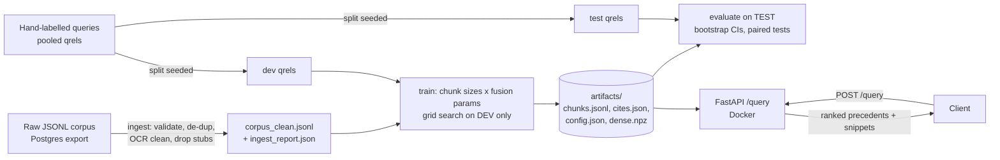

# Retrieval-Augmented Precedent Search for Kenyan Case Law
DSA 8401 Applied Machine Learning, Capstone. Individual submission.

**Problem.** Finding every relevant precedent for a legal issue (e.g. *"land dispute with a fraudulent title
deed in Kiambu"*) in tens of thousands of Kenya Law Reports judgments is slow and error-prone. This project
builds and **rigorously evaluates** a retrieval model for it, and serves it as an API.
The retrieval model is the ML artifact: BM25 + dense embeddings fused with weighted Reciprocal Rank Fusion,
optional citation-graph expansion, hyper-parameters tuned on a dev split and scored on a held-out test split.

> **Status of results.** The bundled data (`data/sample_*`) is a 12-document SYNTHETIC fixture so the whole
> pipeline runs offline in seconds. Its metrics are saturated and are **not results**. Real results require the
> real corpus and hand-labelled queries (see *Using real data*). See `docs/REPORT.md` for the honest status.

## Architecture

```
query ─┬─ BM25 (inverted index) ──┐
       └─ dense embedding ────────┴─ weighted RRF ─ [citation-graph expansion] ─ top-k docs ─ snippets
```

## Quickstart (offline, no databases, ~10 s)
```bash
cd capstone
python -m venv .venv && . .venv/bin/activate
pip install -r requirements.txt -r requirements-dev.txt
make test                       # 21 unit/integration tests (metrics, pipeline, API)
make pipeline                   # ingest -> split -> train -> evaluate on the sample data
python -m rag_eval.pipeline predict --query "fraudulent title deed in Kiambu"
make serve                      # API on :8000  (or: docker compose up --build api)
curl -s localhost:8000/query -H 'content-type: application/json' \
     -d '{"query":"dismissed without a hearing","k":3}'
```
Docker: `docker compose up --build api` serves the committed demo model from `./artifacts`;
`docker compose --profile pipeline run --rm pipeline` re-runs the whole pipeline in a container.

## Pipeline stages (`python -m rag_eval.pipeline <stage>`)
| Stage | What it does | Output |
|---|---|---|
| `ingest` | validate records, drop duplicates/stubs, OCR/format cleaning, remove dangling citation edges, hash input | `data/processed/corpus_clean.jsonl`, `ingest_report.json` |
| `split` | seeded dev/test split of labelled queries | `dev_qrels.jsonl`, `test_qrels.jsonl` |
| `train` | grid search chunk size, RRF k, dense weight, graph expansion on **dev only**; serialize the winner | `artifacts/` (JSONL/JSON/npz, no pickle) |
| `evaluate` | tuned model vs ablations on **test**: recall@k, precision@k, hit@k, MRR, nDCG@k, 95% bootstrap CIs, paired bootstrap vs BM25 | `results/test_results.{md,json}` |
| `predict` | query the serialized model | JSON |

Other tools: `rag_eval.run_eval` (OCR-noise and chunk-size ablations), `rag_eval.export_pg` (export the public
corpus from the Advocatus Postgres/Neo4j), `rag_eval.build_qrels` (pooled, blind relevance labelling).

## Using real data
```bash
pip install asyncpg neo4j
export DATABASE_URL=postgresql://wakili_app:<pw>@localhost:55432/wakili
python -m rag_eval.export_pg --out data/corpus.jsonl --mine-text-citations     # public schema only
# write ~100 realistic queries, one per line, in data/queries.txt, then label them blind (pooled):
python -m rag_eval.build_qrels --corpus data/corpus.jsonl --queries data/queries.txt --out data/qrels.jsonl
python -m rag_eval.pipeline all --raw data/corpus.jsonl --qrels data/qrels.jsonl
# optional learned embeddings: pip install sentence-transformers ; add  --dense st:BAAI/bge-small-en-v1.5
```
Then run `python -m rag_eval.run_eval --corpus data/processed/corpus_clean.jsonl --qrels data/qrels.jsonl --noise 0.1`
for the OCR-noise and chunk-size ablations used in the report.

## API
`POST /query {"query": str, "k": 1..20}` -> ranked precedents (`doc_id, title, court, year, score, snippet`) plus an
*extractive* summary with `[n]` citations. `GET /healthz` reports the loaded model (git sha, params, counts).
Returns 503 if no artifacts are mounted; 422 on invalid input.

## Repository map
`rag_eval/` pipeline, retrievers, metrics, exporter, labelling tool · `rag_service/` FastAPI app ·
`artifacts/` serialized demo model · `data/` synthetic fixture · `tests/` · `docs/REPORT.md` · `AI_USE.md`.
The production product this grew out of (Advocatus, a multi-tenant legal SaaS) lives in the parent repository.
